

# Lexi Game Translator

**One translator. 18 game engines. Play games in your own language — Basic is free, with no account and no sign-in.**

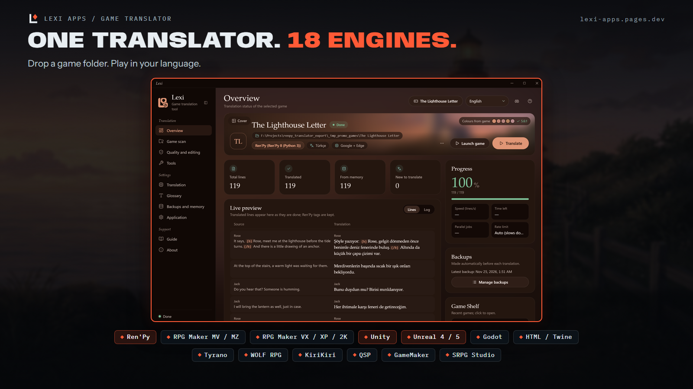

### [⬇️ Download Lexi for Windows](https://github.com/lexi-apps/lexi-renpy-translator/releases/latest)
*Windows 10 / 11 (64-bit) · [Website](https://lexiapps.dev/lexi-game-translator/) · [itch.io](https://lexiapps.itch.io/lexi-game-translator) · [Discord](https://discord.gg/HN9eWThUn2)*

---

**Lexi Game Translator** is a native Windows desktop app that translates games across **18 game engines** into your language. Drop a game folder and Lexi detects the engine, prepares Autopilot bridges and font patches where needed, creates an automatic backup first, and translates dialogue, choices, and interface text cleanly.

Machine translation is a fast way to read and enjoy games in another language, and Lexi's built-in quality checks and line editor let you polish any line whenever you want.

**Lexi Basic is free:** no account, no sign-in, no daily limit, and no lock screen. Install it, drop your game folder, and start translating.

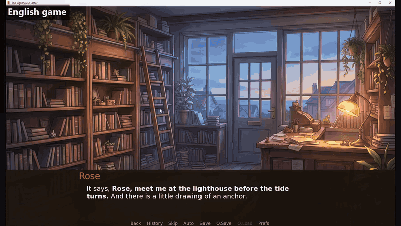

---

## What you get

### Drop it. Click once. (Autopilot & Live Bridge)

For Unity and Unreal games, Lexi Autopilot installs and wires BepInEx/XUnity or UE4SS bridges and font patches automatically — while simpler engines like Ren'Py and RPG Maker keep a clean interface with zero plugin clutter.

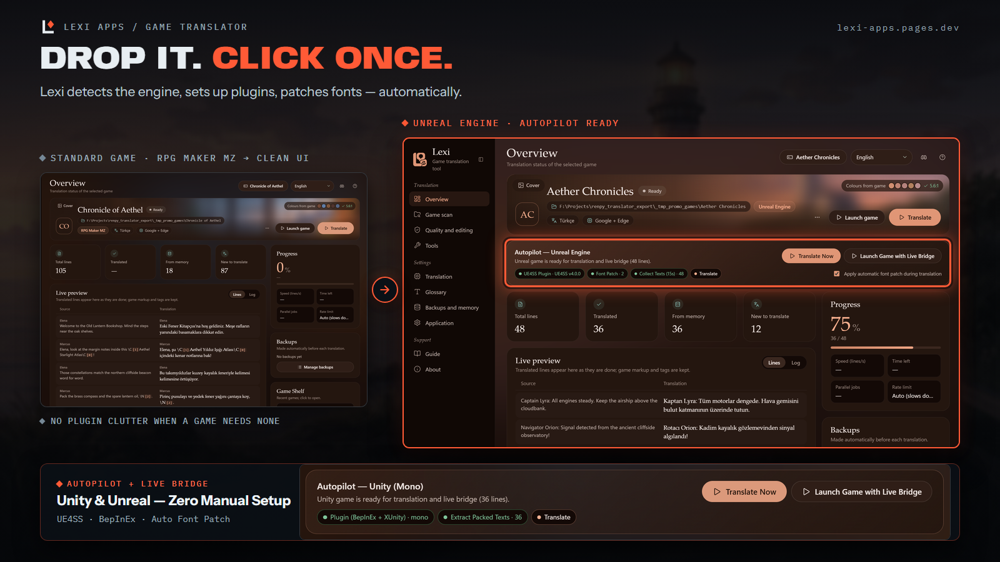

### Three clicks to play

Drop the game folder, pick your target language and translation engine, watch live progress, and launch straight from your Game Shelf.

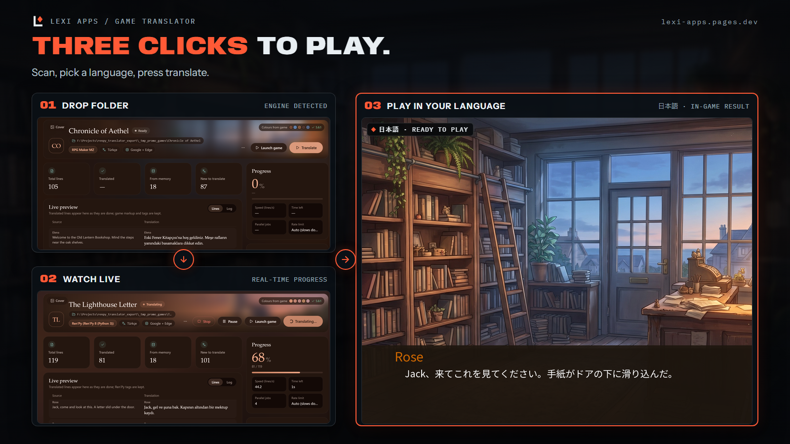

### Real letters, not empty boxes

Automatic font patching adds compatible fonts for Turkish, Cyrillic, Japanese, Korean, Chinese, Thai, and Hindi so text renders cleanly instead of empty boxes.

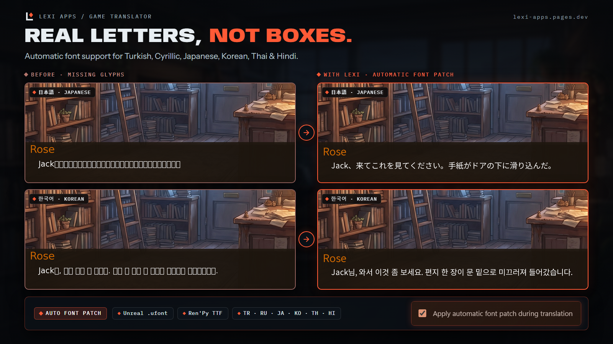

### Names stay names

Character names, speaker tags, choices, and formatting codes stay protected. A character named "Rose" stays Rose instead of turning into the word for the flower.

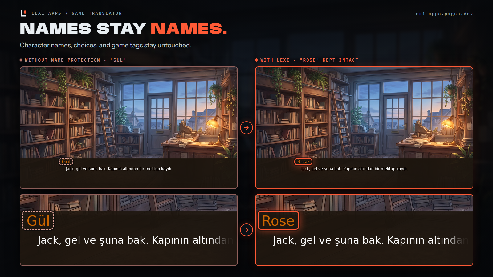

### 12 app languages — including native right-to-left Arabic

Translate into 30+ languages and use Lexi itself in **12 built-in interface languages**: English, Türkçe, العربية (full RTL), Русский, 中文, 日本語, Español, Português (Brasil), Deutsch, Français, 한국어, and Polski.

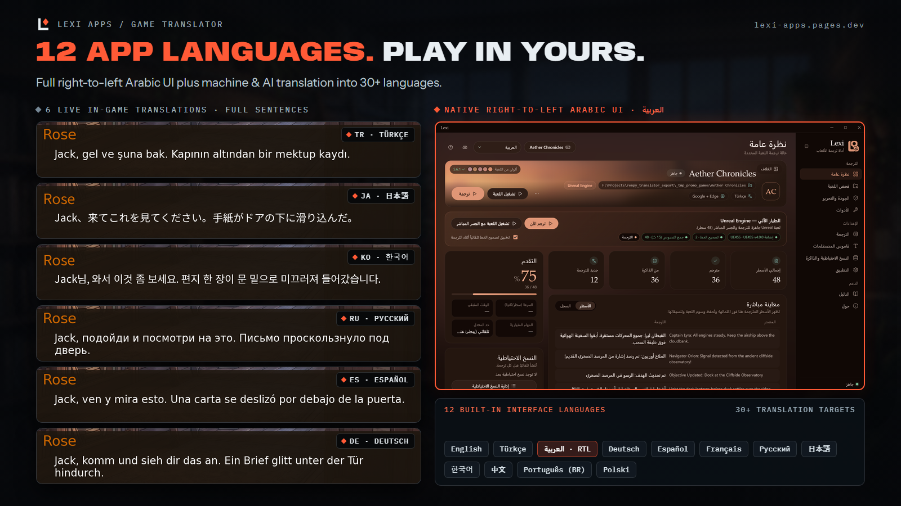

### Dark or light. Fix any line.

Switch between adaptive game-cover dark themes and high-contrast light themes (`Paper Light` & `Daylight Light`). Run quality checks, fix flagged lines with one-click **Retranslate Problems**, import/export CSV, or build a 1-click shareable patch `.zip`.

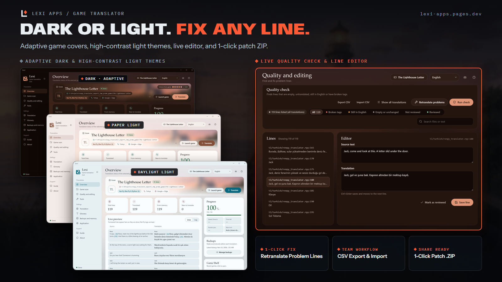

### Free to start. Safe by design.

Unlimited free machine translation, automatic local backups before writing, built-in translation memory for game updates, and optional cloud/local AI presets with upfront estimates and strict cost caps.

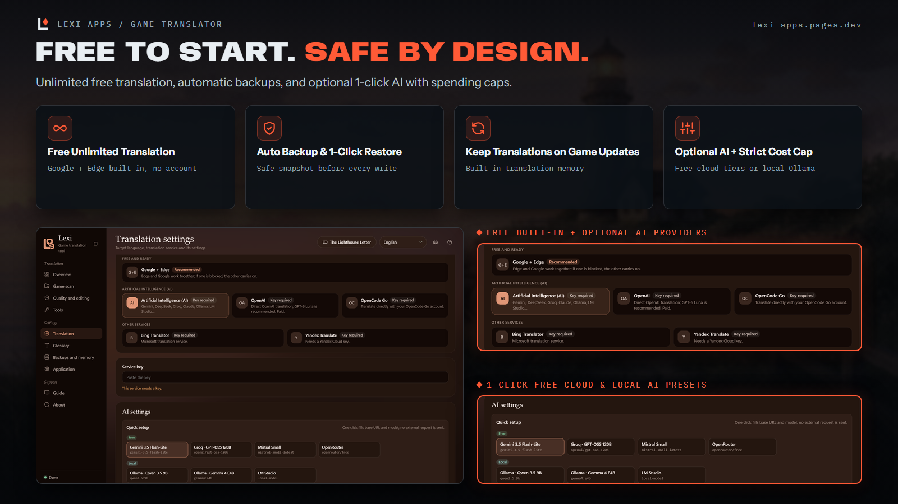

---

## Supported Game Engines (18)

| Engine Family | Supported Versions / Formats | How Lexi Handles It |
|---|---|---|
| **Ren'Py** | `.rpy`, compiled `.rpyc`, `.rpa` archives | Native `tl/<language>/` output, official menu translations, auto font patch, optional in-game language switcher |
| **RPG Maker (Modern)** | RPG Maker MV, RPG Maker MZ | Native JSON/JS text extraction & write-back, control-code protection, auto font patch |
| **RPG Maker (Classic)** | RPG Maker VX Ace, VX, XP, 2000 / 2003 | Native script/map/database extraction & write-back with safe backup before write |
| **Unity** | Unity Mono & Unity IL2CPP | **Autopilot & Live Bridge** (BepInEx + XUnity), packed text extraction & auto font patch |
| **Unreal Engine** | Unreal Engine 4 & Unreal Engine 5 | **Autopilot & Live Bridge** (UE4SS), `.locres`/text handling & `.ufont` automatic font patch |
| **Godot** | Godot 3 & Godot 4 | `.pck` / resource scanning, translation write-back & tag protection |
| **Visual Novel & Scripting** | TyranoScript / TyranoBuilder, WOLF RPG Editor, KiriKiri / KAG, QSP | Native script & scenario extraction, tag/command preservation, backup before write |
| **Web, Indie & Tactical** | HTML / Twine (SugarCube & Harlowe), GameMaker, SRPG Studio | Native HTML/data/JSON string scanning, markup preservation & backup before write |

---

## The app

Lexi is a native Windows desktop app built for speed, readability, and safe local workflows.

More app screenshots (Overview, Autopilot, Quality & Editor, Light Themes, Arabic RTL)

 

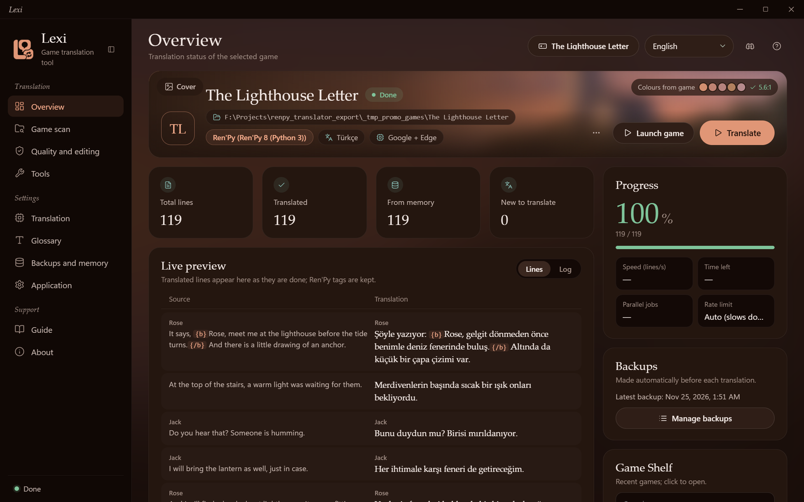

*Overview: live preview, adaptive game cover colors, automatic backups, and Game Shelf.*

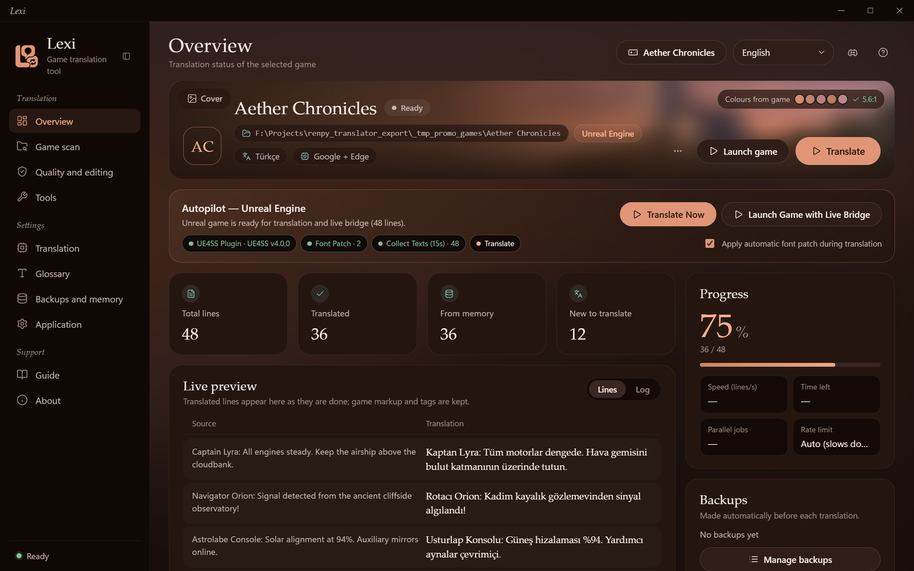

*Autopilot & Live Bridge: automated plugin setup, font patching, and one-click launch for Unity and Unreal titles.*

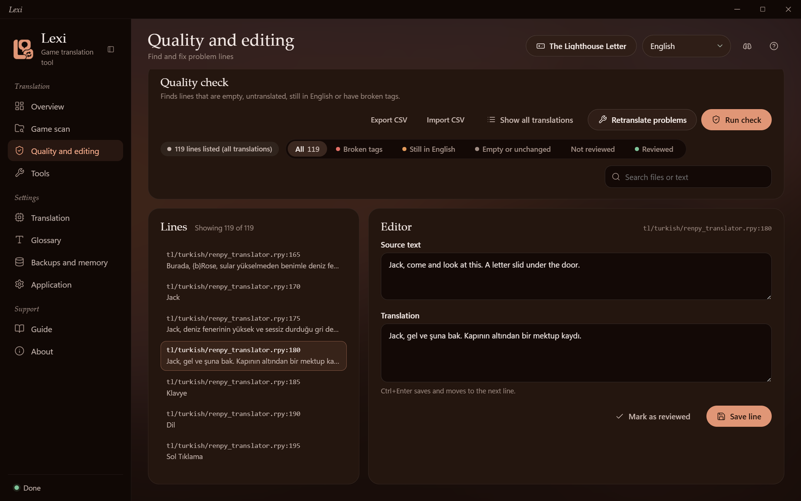

*Quality & editing: spot broken tags or untranslated lines, retranslate problems in one click, edit in place, or export CSV.*

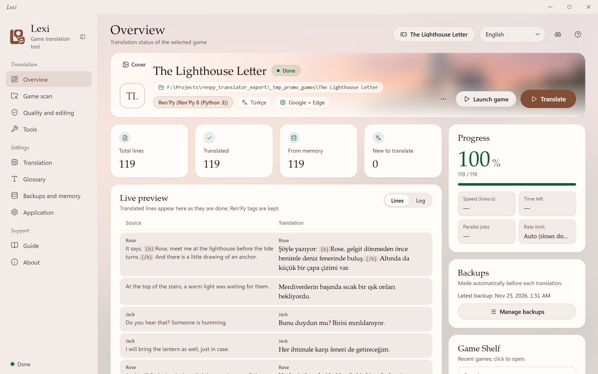

*Light & dark themes: high-contrast Paper Light and Daylight Light alongside adaptive dark palettes.*

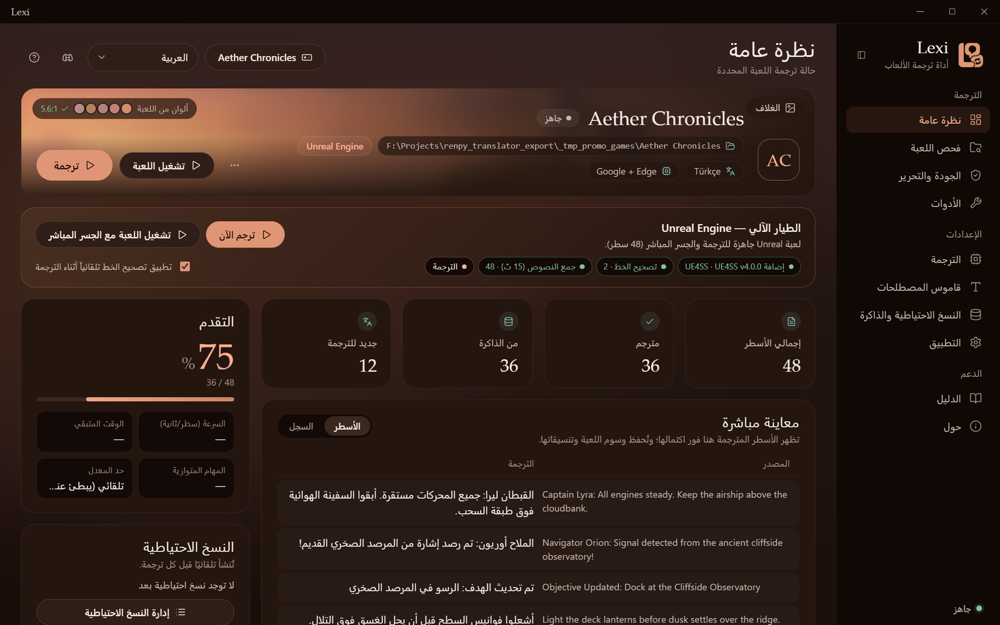

*12 interface languages: includes full native right-to-left Arabic layout.*

---

## Plans

Choose the plan that fits your workflow:

| Plan | Price | Features & Engines | Requirements |
|---|---|---|---|
| **Basic** | **Free** | All **18 game engines**, Autopilot & Live Bridge, Auto Font Patch, backups, Game Shelf, editor, CSV, patch `.zip`, glossary, translation memory, and free machine translation engines (Google, Microsoft Edge, Bing, Yandex, and automatic Free Engine Chain). | None. No account, no sign-in, no key, no daily limit. |
| **Lexi Supporter** | **$4 / mo** | Everything in Basic, plus support ongoing development, early feature previews, and devlogs on Patreon. | Optional Patreon membership. |
| **Lexi Pro** | **$6 / mo** | Everything in Basic, plus **cloud & local AI translation** using your own API key or local server (OpenAI, Claude, Gemini, DeepSeek, Groq, Mistral, OpenRouter, Ollama, LM Studio, and more) with upfront cost estimates and strict spending caps. | Patreon subscription + your own AI API key (or local model). |

### How subscriptions work
- **Optional 3-day trial:** Every computer can start an optional one-time 3-day trial of AI translation features from inside the app. Lexi Basic works without it.
- **Patreon integration:** Subscribe on [Patreon](https://www.patreon.com/cw/LexiApps), open Lexi, and click **Sign in with Patreon**. Your license activates and renews automatically. One license = one computer.
- **Lexi does not lock when a plan ends:** If your trial or subscription ends, Basic keeps working with all 18 engines and free translation; only Pro AI features turn off.

---

## Getting Started

1. **Download:** Grab the latest Windows installer from the [Releases page](https://github.com/lexi-apps/lexi-renpy-translator/releases/latest).
2. **Install:** Run the installer (per-user install, no administrator permissions required).
3. **Open:** Launch Lexi and start using Basic immediately with no account or login.
4. **Drop a game folder:** Lexi automatically detects the engine, counts translatable lines, and checks your translation memory.
5. **Translate & play:** Pick your target language and translation engine, press **Translate**, and launch your game right from Lexi.

---

## Requirements

- **Operating System:** Windows 10 or Windows 11 (64-bit).
- **Internet Connection:** Required for online translation engines and update checks (local Ollama / LM Studio AI presets in Lexi Pro can translate offline once configured).

---

## Privacy & Data

- **Your data stays on your computer:** settings, Game Shelf, translation memory, glossaries, and backups are stored locally.
- **API keys** are stored in the Windows Credential Manager.
- **What leaves your computer:** the text you choose to translate is sent to the translation engine you select (e.g., Google, Microsoft, OpenAI, or your local Ollama endpoint).
- **License server:** contacted only if you start the optional trial or sign in with Patreon. It stores only your machine code (a hash of hardware IDs), your Patreon user ID, license dates, an encrypted Patreon sign-in token, and a salted hash of your IP address for abuse limits. No name and no email.
- **Report a problem** sends a redacted log (API keys, license key, and Windows username stripped automatically) and your message — only when you click Send.
- **Uninstalling** Lexi does not delete your saved translations or backups.
- **Verified updates:** update packages are checked with a digital signature and SHA-256 before installing. Automatic update checks can be turned off in Settings.

---

## Frequently Asked Questions

#### Is Lexi really free?
Yes. The **Basic** plan is free across all 18 supported engines, with no account, no sign-in, and no daily limit.

#### Do I need an account or an API key to use Lexi?
No. Basic works right away with built-in free machine translation engines. Patreon sign-in and API keys (or local AI servers) are only needed if you want Lexi Pro AI translation.

#### What happens when my Pro trial or subscription ends?
Lexi does not lock. Basic continues working with all 18 engines and free machine translation; only Lexi Pro AI features turn off.

#### Windows SmartScreen warns me when I run the installer. Is that normal?
Windows may show "Windows protected your PC" the first time you run the installer because the binary is not code-signed yet (code-signing certificates are paid). Each release includes SHA-256 checksums and is scanned on VirusTotal before publishing. Click **More info**, then **Run anyway**, and always download from the [official GitHub releases page](https://github.com/lexi-apps/lexi-renpy-translator/releases).

#### How does Lexi protect my game files?
Before writing translations or patches, Lexi creates an automatic local backup of the affected files so you can restore your original files in one click from the Backups panel.

#### Can I disable automatic update checks?
Yes. You can turn off automatic update checks anytime in Settings.

---

## Support & Bug Reports

- **In the app:** open **About → Report a problem** (secrets and Windows usernames are automatically redacted).
- **Discord:** join the community on [Discord](https://discord.gg/HN9eWThUn2).
- **GitHub Issues:** open an issue on [GitHub Issues](https://github.com/lexi-apps/lexi-renpy-translator/issues) with your Windows version, game engine, and translation engine.
- **Support development:** subscribe on [Patreon](https://www.patreon.com/cw/LexiApps) (Lexi Supporter / Lexi Pro) or leave a voluntary one-time tip on [Buy Me a Coffee](https://buymeacoffee.com/lexiapps) (donations only; licenses are on Patreon).

---

## More from Lexi Apps

- **Website:** [lexiapps.dev](https://lexiapps.dev/)
- **[Lexi Download Manager](https://lexiapps.dev/lexi-download-manager/)** ([GitHub](https://github.com/lexi-apps/lexi-download-manager)): a free multi-part download manager for Windows, with no ads and no account.
- **[LexiDictate](https://lexiapps.dev/lexi-dictate/)** ([GitHub](https://github.com/lexi-apps/lexi-dictate)): fast system-wide voice dictation and on-screen selection translation for Windows.

---

## License

Lexi Game Translator is closed-source software. The source code is not part of this repository, which hosts official releases and documentation.

---

🇹🇷 Türkçe özet

### Lexi Oyun Çevirmeni

**Lexi Oyun Çevirmeni**, **18 farklı oyun motorundaki** oyunları kendi dilinize çeviren yerel bir Windows masaüstü uygulamasıdır (Windows 10/11, 64-bit).

#### Öne Çıkan Özellikler
- **18 Oyun Motoru:** Ren'Py, RPG Maker (2000/2003, XP, VX, VX Ace, MV, MZ), Unity (Mono ve IL2CPP), Unreal Engine 4 ve 5, Godot 3 ve 4, Tyrano, WOLF RPG, KiriKiri, QSP, HTML/Twine, GameMaker ve SRPG Studio.
- **Otopilot ve Canlı Köprü:** Unity ve Unreal oyunlarında eklenti kurulumunu ve font yamasını otomatik hazırlar; Ren'Py ve RPG Maker gibi motorlarda sade arayüz sunar.
- **Basic Ücretsiz:** Hesap, giriş, lisans anahtarı veya günlük sınır olmadan Google, Microsoft Edge, Bing, Yandex ve otomatik ücretsiz motor zinciriyle sınırsız çeviri yapabilirsiniz.
- **Otomatik Yedek ve Güvenlik:** Oyun klasörüne yazmadan önce otomatik yerel yedek alınır; tek tıkla geri yüklenebilir.
- **Otomatik Font Yaması ve İsim Koruması:** Türkçe, Kiril, Japonca, Korece, Çince, Tayca ve Hintçe için otomatik font yaması uygulanır; karakter adları, değişkenler ve etiketler korunur.
- **Kalite Editörü, CSV ve Yama `.zip`:** Bozuk etiketleri veya çevrilmemiş satırları bulur, tek tıkla **Sorunları Yeniden Çevir** çalıştırır, CSV içe/dışa aktarır ve paylaşılabilir yama `.zip` üretir.
- **12 Arayüz Dili ve Açık/Koyu Temalar:** Tam sağdan sola (RTL) Arapça dâhil 12 arayüz dili, oyun kapağına uyumlu koyu temalar ve yüksek kontrastlı açık temalar (`Paper Light`, `Daylight Light`).
- **Planlar:**
  - **Basic (Ücretsiz):** 18 oyun motoru, Otopilot, makine çevirisi motorları, kalite editörü, sözlük, çeviri belleği ve yedekleme araçları.
  - **Lexi Supporter (4 $/ay):** Geliştirmeye destek, erken önizlemeler ve geliştirme günlükleri.
  - **Lexi Pro (6 $/ay):** Basic özelliklerine ek olarak kendi API anahtarınızla veya yerel sunucunuzla (OpenAI, Claude, Gemini, DeepSeek, Groq, Mistral, OpenRouter, Ollama, LM Studio) yapay zekâ çevirisi ve maliyet sınırı.
- **İsteğe bağlı 3 günlük Pro denemesi:** Her bilgisayarda bir kez uygulama içinden başlatılabilir; süre dolunca program kilitlenmez, Basic çalışmaya devam eder.
- **Abonelik:** [Patreon](https://www.patreon.com/cw/LexiApps) üzerinden abone olup uygulama içinden **Sign in with Patreon** ile giriş yapılır (1 lisans = 1 bilgisayar).

#### Hızlı Başlangıç
1. [Releases](https://github.com/lexi-apps/lexi-renpy-translator/releases/latest) sayfasından Windows kurulum dosyasını indirin.
2. Kurulumu çalıştırın (yönetici yetkisi gerekmez). Windows SmartScreen çıkarsa **Ek bilgi → Yine de çalıştır** seçeneğini kullanın.
3. Lexi'yi açın, oyun klasörünü bırakın, hedef dili ve çeviri motorunu seçip çeviriyi başlatın.

---
**Website:** https://lexiapps.dev/ · **Discord:** https://discord.gg/HN9eWThUn2 · **Patreon:** https://www.patreon.com/cw/LexiApps · **Buy Me a Coffee:** https://buymeacoffee.com/lexiapps
