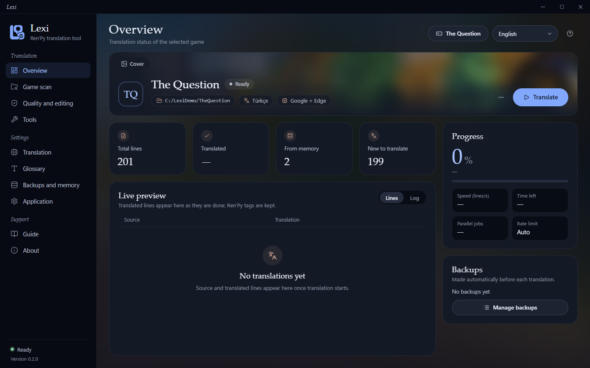
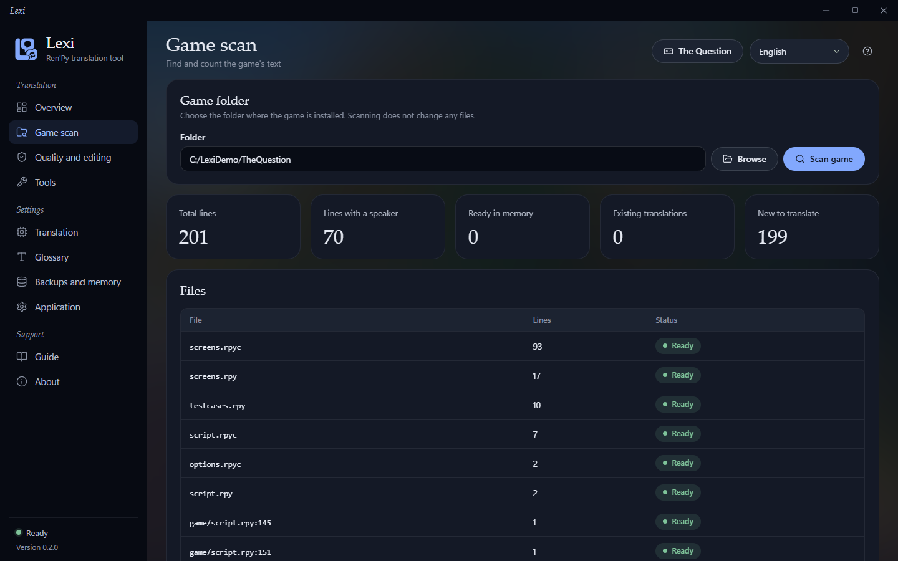
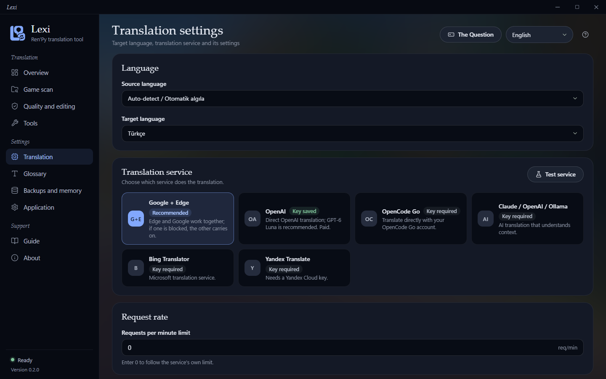
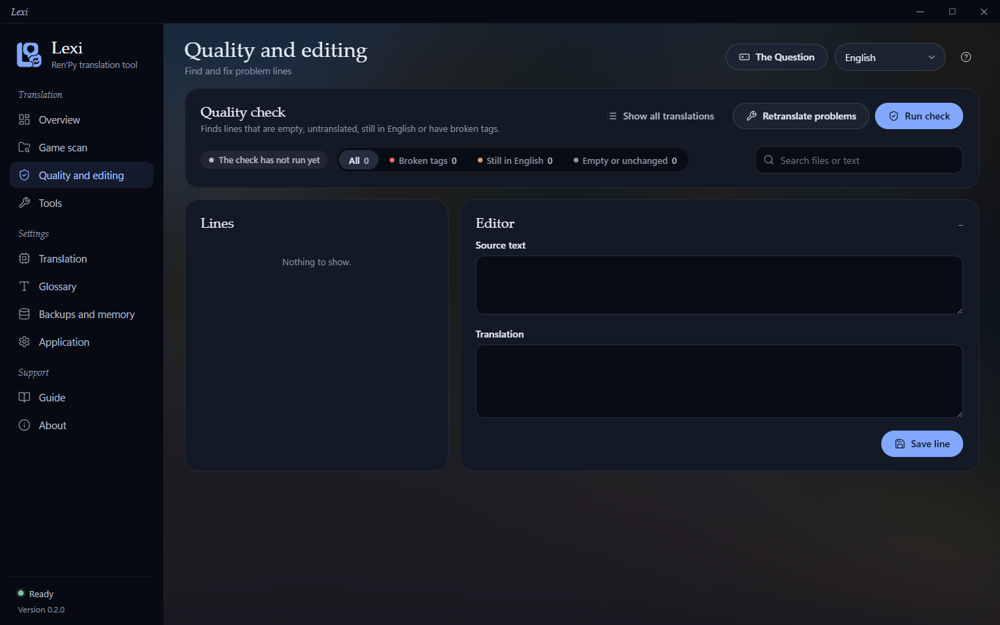
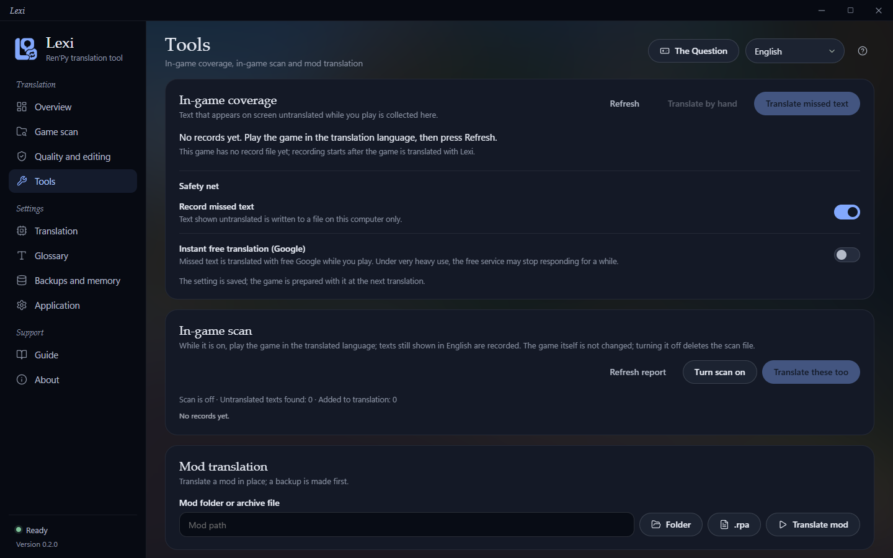
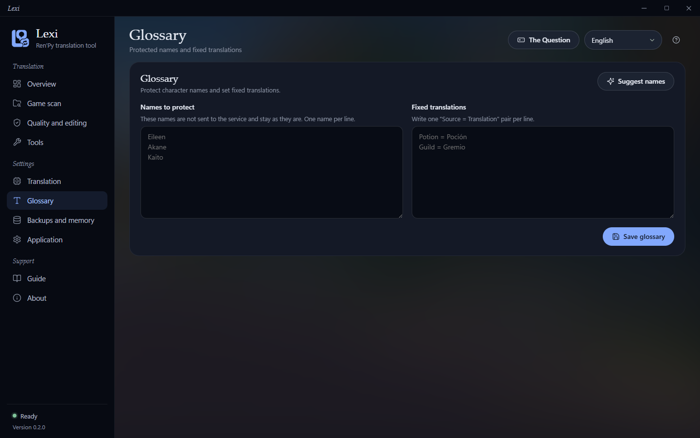
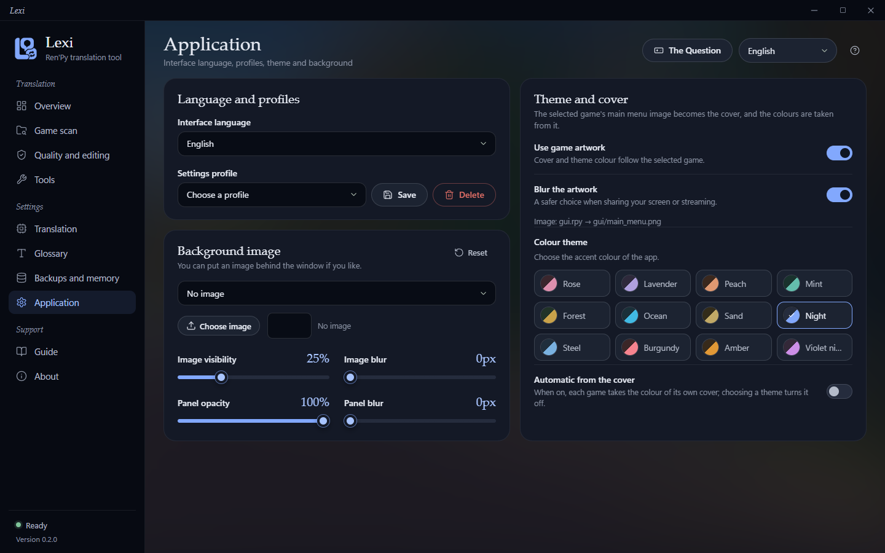
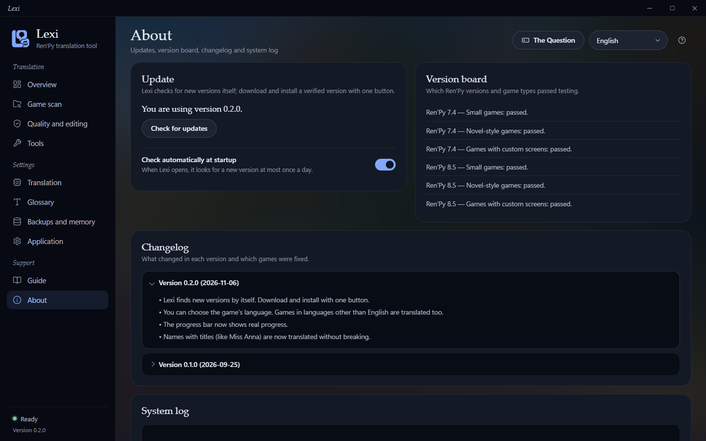

 

# Lexi — Ren'Py Translator

**Translate Ren'Py visual novels into your language — safely, accurately, and without breaking the game.**

### [⬇️ Download Lexi 0.3.0 for Windows](https://github.com/lexi-apps/lexi-renpy-translator/releases/latest)
*Installer: `Lexi-RenPy-Translator-Setup-0.3.0.exe` (~125 MB, Windows 10/11 64-bit)*

---

**Lexi** is a dedicated Windows desktop application designed to translate Ren'Py visual novels into any language. It scans dialogue, interface text, and menus directly from your game files, translates them using modern translation engines, and writes clean, native translation scripts via Ren'Py's built-in translation framework.

Starting with version 0.3.0, **Lexi Basic is completely free**. No account, no sign-in, no daily limits, and no startup lock screens. Just install, select your game, and start translating.

---

## Highlights

- **Completely Free Basic Tier:** Translate with Google, Microsoft Edge, Bing, Yandex, or the automatic free fallback chain without paying, signing up, or entering API keys.
- **Your game stays safe:** Automatic backup before anything is written, with one-click restore.
- **Code & Tag Preservation:** Ren'Py dialogue tags (`{b}`, `{i}`, `{color}`...), interpolation variables (`[name]`), and formatting codes stay intact. Damaged lines are detected and retried automatically.
- **Broad Format Support:** Works directly with `.rpy` script files, compiled `.rpyc` files (via built-in decoder), and `.rpa` game archives.
- **No surprise bills:** Paid engines show an estimated cost and ask for your approval before starting, and you can set a cost ceiling.
- **Integrated Quality Tools:** In-game coverage checks, translation memory caching, glossaries for character names, and a built-in line editor.

---

## Screenshots

Lexi runs as a native desktop app on Windows. The screenshots below highlight the interface using the Ren'Py SDK demo game (*The Question*) in the dark "Night" theme.

| | |
|---|---|
|  |  |
| **Overview**: progress, backups and live preview of the translation | **Game scan**: counts the lines of text in a game folder without changing any files |
|  |  |
| **Translation settings**: pick the target language and the translation service | **Quality and editing**: find broken, untranslated or empty lines and fix them in place |
|  |  |
| **Tools**: in-game coverage, in-game scan and mod translation | **Glossary**: protect character names and set fixed translations |
|  |  |
| **Application**: interface language, colour themes and background | **About**: update check, Ren'Py version board and changelog |

---

## Plans

Choose the plan that matches your translation workflow:

| Plan | Price | Features & Engines | Requirements |
|---|---|---|---|
| **Basic** | **Free** | Machine translation via Google, Microsoft Edge, Bing, Yandex, and the automatic Free Engine Chain (Google + Edge fallback). Includes all scanning, editing, backup, and glossary tools. | None. No account, no sign-in, no key, no daily limit. |
| **Plus** | **$7 / mo** | Everything in Basic, plus **AI translation** using your own API key (OpenAI and other AI providers). | Patreon subscription + your own AI API key. |
| **Pro** | **$12 / mo** | Everything in Plus, plus **monthly Lexi AI credits** included directly. *(Coming soon)* | Patreon subscription. *(In development)* |

### How subscriptions work
- **Optional 3-day free trial:** Every computer can start a one-time 3-day trial of Plus features from inside the app. The trial is optional; Lexi works without it.
- **Patreon integration:** Subscribe on [Patreon](https://www.patreon.com/cw/LexiApps), open Lexi, and click **Sign in with Patreon**. Your license activates and renews automatically (one license per computer).
- **Lexi does not lock when a plan ends:** If your trial or subscription ends, Basic keeps working; only the Plus features turn off.

---

## Features

### 🔎 Scanning & Native Output
- Discovers dialogue lines, choices, menus, and user interface strings.
- Handles standard `.rpy` scripts, compiled `.rpyc` binaries, and packed `.rpa` game archives seamlessly.
- Generates clean files in the game's native `tl/<language>/` directory using standard Ren'Py syntax.
- Optional automatic in-game language switcher injection.
- Safety net for text that would otherwise escape translation in-game, plus a coverage check.

### 🌐 Translation Engines
- **Free Machine Translation:** Access Google, Microsoft Edge, Bing, Yandex, and the dual-service free engine chain with automatic fallback.
- **Bring Your Own AI Key (Plus):** Connect your own API keys for OpenAI (GPT models) and additional AI providers.
- **Source Languages:** Automatic language detection or manual selection: English, Japanese, Chinese, Korean, Russian, Spanish, Portuguese, German, French, Italian, Polish, Turkish, Indonesian, Vietnamese, Thai.
- **Target Languages:** Any target language supported by the selected translation engine.

### 💰 Cost Control & Budget Protection
- Upfront cost estimates calculated and displayed before any paid API operation begins.
- Configurable maximum budget ceilings prevent unexpected API charges.
- Translation memory (caching) stores previously translated phrases to avoid redundant translations and API costs.

### 🛡️ Code Protection & Quality Assurance
- Preserves Ren'Py tags (`{b}`, `{i}`, `{color}`…), variables (`[name]`) and format codes.
- Detects damaged lines and retries them automatically.
- Quality check and a built-in translation editor for manual fixes.
- Glossary (term list) to keep character names and terms consistent.
- Translations saved per game; mod translation supported.

### 🎨 User Interface & Customization
- **11 interface languages:** English, Türkçe, Русский, 中文, 日本語, Español, Português (Brasil), Deutsch, Français, 한국어, Polski.
- **12 curated color themes** plus support for custom background wallpapers.
- Automatic updates from this repository, installed with one click.

---

## Getting Started

1. **Download:** Grab the latest `Lexi-RenPy-Translator-Setup-0.3.0.exe` installer from the [Releases page](https://github.com/lexi-apps/lexi-renpy-translator/releases/latest).
2. **Install:** Run the installer. It installs per-user in your local profile, requiring no administrator permissions.
3. **Open:** Launch Lexi. You are immediately ready to use the free Basic tier—no registration or login necessary. (Optional: Click *Sign in with Patreon* or start the 3-day trial if you wish to use Plus AI features).
4. **Configure:** Select your Ren'Py game folder, set your target language, and pick your preferred translation engine.
5. **Translate & Play:** Run the translation, review or refine lines in the built-in editor, and launch your translated visual novel.

---

## Requirements

- **Operating System:** Windows 10 or Windows 11 (64-bit).
- **Disk Space:** Approximately 125 MB for the installer.
- **Internet Connection:** Required for online translation engines and checking for application updates.

---

## Privacy & Safety

- **Your data stays on your computer:** settings, translation memory and backups are stored locally.
- **API keys** are stored in the Windows Credential Manager.
- **What leaves your computer:** the text you translate is sent to the online translation engine you choose (for example Google, Microsoft, OpenAI).
- **License server:** contacted only if you start the trial or sign in with Patreon. It stores only your machine code (a hash of hardware IDs), your Patreon user ID, license dates, an encrypted Patreon sign-in token, and a salted hash of your IP address for abuse limits. No name and no email.
- **Report a problem** sends a cleaned log (keys, license key and your Windows user name removed) and your description, and only when you press Send.
- **Uninstalling** Lexi does not delete your data.
- **Verified updates:** update files are checked with a digital signature and SHA-256 before installing. The automatic update check connects to GitHub and can be turned off in Settings.

---

## Frequently Asked Questions

#### Is Lexi really free?
Yes. Since version 0.3.0 the **Basic** plan is free: no account, no sign-in and no daily limit. You can translate whole games with the machine translation engines right away.

#### Do I need an account or an API key to use Lexi?
No. You do not need an account, Patreon sign-in, or API key to use the free Basic tier. API keys and Patreon sign-in are only needed if you want to use Plus features for AI models (such as OpenAI).

#### What happens when my Plus trial or subscription ends?
Lexi does not lock. Basic keeps working with the free engines; only the Plus features turn off.

#### Windows SmartScreen warns me when I run the installer. Is that normal?
The installer is not code-signed yet, so SmartScreen may show a warning. Click **More info → Run anyway** to continue.

#### Will Lexi change my game files?
Lexi writes the translation into the game folder through Ren'Py's own `tl/<language>/` system. Before writing anything it makes an automatic backup, which you can restore with one click.

#### Can I disable automatic update checks?
Yes. You can disable automatic update checks at any time in the application settings.

---

## Support Lexi

Lexi's Plus and Pro plans are on **[Patreon](https://www.patreon.com/cw/LexiApps)**. Your support pays for development, testing on more games and new features.

---

## Reporting Bugs

Encountered an issue?
- **In the app:** open the **About** tab and press **Report a problem** to send an error report (Lexi also offers to report after a crash).
- **GitHub:** Open a ticket on [GitHub Issues](https://github.com/lexi-apps/lexi-renpy-translator/issues) detailing what occurred, your Lexi version (0.3.0), your Windows version, and the game or translation engine involved.

---

## License

Lexi is closed-source software. The source code is not part of this repository, which only hosts releases and this page.

---

🇹🇷 Türkçe özet

### Lexi — Ren'Py Çevirici

**Lexi**, Ren'Py görsel roman oyunlarını başka dillere çeviren bir Windows masaüstü programıdır (Windows 10/11, 64-bit).

#### 0.3.0 ile Gelen Yenilikler ve Temel Özellikler
- **Basic Artık Tamamen Ücretsiz:** Hesap açma, giriş yapma, lisans anahtarı veya günlük kullanım sınırı yoktur. Kurulumun hemen ardından Google, Microsoft Edge, Bing, Yandex ve otomatik geçişli ücretsiz motor zinciri ile sınırsız çeviri yapabilirsiniz.
- **Açılış Kilidi Yok:** Program doğrudan açılır; deneme süresi veya abonelik sona erdiğinde program kilitlenmez, ücretsiz Basic sürümde çalışmaya devam eder.
- **Oyun güvenliği:** Bir şey yazılmadan önce otomatik yedek alınır; tek tıkla geri dönebilirsiniz.
- **Kod ve Etiket Koruması:** Ren'Py metin etiketleri (`{b}`, `{color}` vb.), değişkenler (`[name]`) ve biçimlendirmeler korunur; hasarlı satırlar tespit edilip otomatik olarak yeniden denenir.
- **Geniş Dosya Desteği:** Standart `.rpy` betikleri, derlenmiş `.rpyc` dosyaları (dahili çözücü) ve `.rpa` arşiv paketleri doğrudan taranır ve çeviriler Ren'Py'ın yerel `tl/<dil>/` klasörüne yazılır.
- **Planlar:**
  - **Basic (Ücretsiz):** Tüm makine çeviri motorları, tarama, kalite editörü, sözlük ve yedekleme araçları.
  - **Plus (7 $/ay):** Basic özelliklerine ek olarak kendi API anahtarınızla OpenAI ve diğer yapay zekâ motorlarını kullanma imkânı.
  - **Pro (12 $/ay):** Plus özelliklerine ek olarak her ay dahil edilen Lexi yapay zekâ kredileri *(yakında)*.
- **3 günlük Plus denemesi:** Her bilgisayarda bir kez, isteğe bağlı olarak uygulama içinden başlatılabilir.
- **Abonelik:** [Patreon](https://www.patreon.com/cw/LexiApps) üzerinden abone olduktan sonra uygulama içinde **Sign in with Patreon** düğmesine tıklayarak lisansınızı otomatik olarak etkinleştirebilirsiniz (1 lisans = 1 bilgisayar).
- **Arayüz:** 11 dil, 12 renk teması ve özel arka plan.
- **Gizlilik:** Ayarlar, çeviri hafızası ve yedekler bilgisayarınızda kalır; çevrilen metin seçtiğiniz çevrimiçi çeviri motoruna gider. API anahtarları Windows Kimlik Bilgisi Yöneticisi'nde saklanır. Lisans sunucusuna yalnız denemeyi başlatırsanız ya da Patreon ile giriş yaparsanız bağlanılır; yalnız makine kodunu (donanım kimliklerinin özeti), Patreon kullanıcı numaranızı, lisans tarihlerini, şifreli Patreon giriş jetonunu ve IP'nin tuzlu özetini saklar; ad ve e-posta yoktur.

#### Hızlı Başlangıç
1. [Releases](https://github.com/lexi-apps/lexi-renpy-translator/releases/latest) sayfasından `Lexi-RenPy-Translator-Setup-0.3.0.exe` kurulum dosyasını indirin.
2. Kurulumu çalıştırın (yönetici yetkisi gerektirmez). SmartScreen uyarısı çıkarsa "More info → Run anyway" seçeneğini kullanın.
3. Lexi'yi açın, oyun klasörünü, hedef dili ve çeviri motorunu seçip çeviriyi başlatın.

